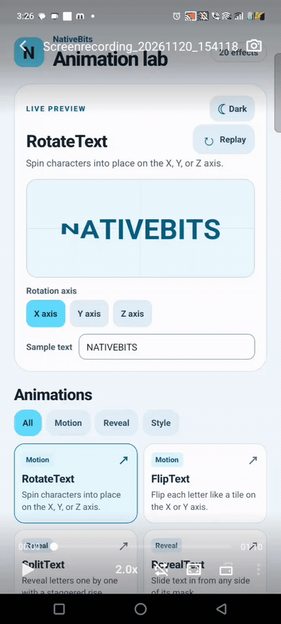

# NativeBits

Animated text for React Native. Reveal a heading character by character, cycle through phrases, add a gradient or neon glow, scatter letters, or count up to a number. NativeBits includes 20 components and exports their TypeScript prop types.

Try all 20 effects in the [NativeBits demo app for React Native](https://github.com/Rojithmuthaiya/nativebits-demo). The demo includes editable sample text, presets, and replay controls.



- [Installation](#installation)
- [Quick start](#quick-start)
- [Component reference](#component-reference)
- [Troubleshooting](#troubleshooting)
- [Contributing](#contributing)

## Installation

Install NativeBits and its peer dependencies **in your React Native app**.

| Dependency | NativeBits peer requirement |
| --- | --- |
| React | 19 or later |
| React Native | 0.79 or later with the New Architecture enabled |
| React Native Reanimated | 4.x, starting at 4.1.0 |
| React Native Worklets | 0.7.0 or later |
| Shopify React Native Skia | 2.14.0 or later |

These are package requirements. Choose versions that also work together with your React Native version or Expo SDK. Reanimated and Worklets handle animations, and Skia draws canvas effects such as gradients, glow, and particles. Install all three for the public package entry point. [Reanimated compatibility table](https://docs.swmansion.com/react-native-reanimated/docs/guides/compatibility/) · [Skia installation](https://wcandillon.github.io/react-native-skia/v2/docs/getting-started/installation/)

The Android demo uses React Native 0.88.1, React 19.3.0, Reanimated 4.7.1, Worklets 0.13.1, and Skia 2.14.0. iOS playback has yet to be verified.

### Expo

Use an Expo SDK whose compatible dependencies meet the versions above.

```sh
npx expo install react-native-reanimated react-native-worklets @shopify/react-native-skia
npm install nativebits-animated-text
npx expo start --clear
```

The standard `babel-preset-expo` configures the Worklets plugin automatically. If you use a custom development build, rebuild it after adding or upgrading native dependencies. For Expo Go, use a client with the matching native dependency versions. [Expo Reanimated guide](https://docs.expo.dev/versions/latest/sdk/reanimated/) · [Expo Skia guide](https://docs.expo.dev/versions/latest/sdk/skia/)

### React Native Community CLI

For the React Native 0.88.1 setup shown in the demo, install these versions. For a different React Native version, check compatibility before choosing your pins.

```sh
npm install react-native-reanimated@4.7.1 react-native-worklets@0.13.1 @shopify/react-native-skia@2.14.0
npm install nativebits-animated-text
```

Add `react-native-worklets/plugin` as the **last** plugin in your app's `babel.config.js`. Keep any Babel presets and plugins your app already uses.

```js
module.exports = {
  presets: ['module:@react-native/babel-preset'],
  plugins: ['react-native-worklets/plugin'],
};
```

For iOS, run `npx pod-install` from the app root on macOS. Restart Metro with a clean cache and rebuild the native app. [Reanimated Community CLI guide](https://docs.swmansion.com/react-native-reanimated/docs/fundamentals/getting-started/#react-native-community-cli)

```sh
npm start -- --reset-cache
```

In a second terminal, use `npm run android` for Android or `npm run ios` on macOS in a standard Community CLI project.

## Quick start

```tsx
import React from 'react';
import { View } from 'react-native';
import { SplitText, type SplitTextProps } from 'nativebits-animated-text';

const heading: SplitTextProps = {
  text: 'Welcome to NativeBits',
  duration: 450,
  stagger: 35,
  fromY: 16,
  style: { fontSize: 28, fontWeight: '700', color: '#171717' },
};

export default function App() {
  return (
    <View style={{ flex: 1, justifyContent: 'center', padding: 24 }}>
      <SplitText {...heading} />
    </View>
  );
}
```

## Component reference

Import the component used in each example from `nativebits-animated-text`. Each has a corresponding named prop type such as `ExplosionTextProps`. Required inputs are marked in the tables. Timing values are in milliseconds and layout distances are in React Native layout points unless specified.

| Effect | Components |
| --- | --- |
| Reveals and phrase transitions | [SplitText](#splittext), [BlurText](#blurtext), [RevealText](#revealtext), [TypewriterText](#typewritertext), [ScrambleText](#scrambletext), [RotateText](#rotatetext), [FlipText](#fliptext), [MorphText](#morphtext) |
| Color and lighting | [GradientText](#gradienttext), [ShinyText](#shinytext), [NeonText](#neontext), [ThreeDText](#threedtext), [GlitchText](#glitchtext) |
| Motion and particles | [WaveText](#wavetext), [TextWave](#textwave), [BounceText](#bouncetext), [ElasticText](#elastictext), [ParticleText](#particletext), [ExplosionText](#explosiontext) |
| Numbers | [CountUpText](#countuptext) |

For Skia components, `style` controls the font options listed in each table. Use `containerStyle` for layout. Canvas colors come from the component's color props or the style fields listed in its table.

### SplitText

Slides and fades in each character in sequence.

```tsx
<SplitText text="Welcome aboard" fromY={24} stagger={45} />
```

| Prop | Type | Default | Description |
| --- | --- | --- | --- |
| `text` | `string` | **Required** | Text to reveal. |
| `duration` | `number` | `450` | Animation time per character. |
| `stagger` | `number` | `35` | Time between character starts. |
| `delay` | `number` | `0` | Wait before the first character starts. |
| `fromY` | `number` | `16` | Initial vertical offset. Positive values start below the resting position. |
| `style` | `StyleProp<TextStyle>` | — | Base style applied to each character. |
| `characterStyle` | `StyleProp<TextStyle>` | — | Per-character style applied after the base style. |
| `containerStyle` | `StyleProp<ViewStyle>` | — | Wrapping container style. |

### BlurText

Slides characters into focus using a Skia blur.

```tsx
<BlurText text="Coming into focus" blur={14} fromY={12} />
```

| Prop | Type | Default | Description |
| --- | --- | --- | --- |
| `text` | `string` | **Required** | Text to bring into focus. |
| `duration` | `number` | `600` | Animation time per character. |
| `stagger` | `number` | `50` | Time between character starts. |
| `delay` | `number` | `0` | Wait before the first character starts. |
| `fromY` | `number` | `20` | Initial vertical offset. |
| `blur` | `number` | `10` | Starting blur radius. |
| `style` | `TextStyle` | — | Canvas font size, family, weight, font style, and sharp text color. |
| `containerStyle` | `ViewStyle` | — | Outer container style. |
| `blurColor` | `string` | Text color | Color of the blurred text layer. |
| `blurGradient` | `string[]` | — | Optional gradient for the blur layer. Supply at least two colors. |

### RevealText

Uncovers text with a directional wipe. It can reveal characters or whole words.

```tsx
<RevealText text="One word at a time" mode="word" direction="bottom" slide />
```

| Prop | Type | Default | Description |
| --- | --- | --- | --- |
| `text` | `string` | **Required** | Text to reveal. |
| `direction` | `'left' \| 'right' \| 'top' \| 'bottom'` | `'left'` | Edge where the reveal begins. |
| `duration` | `number` | `700` | Animation time per character or word. |
| `delay` | `number` | `0` | Wait before the reveal starts. |
| `stagger` | `number` | `45` | Time between character or word starts. |
| `mode` | `'word' \| 'character'` | `'character'` | Unit to reveal at each step. |
| `fade` | `boolean` | `true` | Fade in each unit during the wipe. |
| `slide` | `boolean` | `false` | Slide each unit as it is revealed. |
| `slideDistance` | `number` | `20` | Travel distance when slide is enabled. |
| `loop` | `boolean` | `false` | Repeat the reveal. |
| `style` | `TextStyle` | — | Base text style. |
| `characterStyle` | `TextStyle` | — | Additional style for each animated character or word. |
| `containerStyle` | `ViewStyle` | — | Outer container style. |

### TypewriterText

Types and erases phrases with a customizable cursor. With looping disabled, the final phrase stays visible.

```tsx
<TypewriterText texts={['Build it.', 'Animate it.']} cursorColor="#7C3AED" loop />
```

| Prop | Type | Default | Description |
| --- | --- | --- | --- |
| `texts` | `string[]` | **Required** | Phrases to type in order. |
| `typingSpeed` | `number` | `80` | Time between typing steps. |
| `deletingSpeed` | `number` | `40` | Time between deletion steps. |
| `pauseDuration` | `number` | `1500` | Time to hold a phrase before erasing it. |
| `loop` | `boolean` | `false` | Start over after the final phrase. |
| `cursorWidth` | `number` | `2` | Cursor width. |
| `cursorHeight` | `number` | `26` | Cursor height. |
| `cursorColor` | `string` | `'#FFFFFF'` | Cursor fill color. |
| `cursorBorderRadius` | `number` | `2` | Cursor corner radius. |
| `cursorMarginLeft` | `number` | `3` | Space between the text and cursor. |
| `cursorAnimation` | `'blink' \| 'pulse' \| 'none'` | `'blink'` | Cursor opacity animation. |
| `cursorAnimationDuration` | `number` | `500` | Duration of a cursor animation step. |
| `style` | `TextStyle` | — | Typed text style. |
| `cursorStyle` | `ViewStyle` | — | Additional cursor style. |
| `containerStyle` | `ViewStyle` | — | Outer container style. |

### ScrambleText

Replaces random characters with the final text from left to right.

```tsx
<ScrambleText text="ACCESS GRANTED" characters="01#$" speed={45} />
```

| Prop | Type | Default | Description |
| --- | --- | --- | --- |
| `text` | `string` | **Required** | Final text to reveal. |
| `characters` | `string` | `'ABCDEFGHIJKLMNOPQRSTUVWXYZabcdefghijklmnopqrstuvwxyz0123456789!@#$%^&*'` | Pool of characters used for scrambling. |
| `speed` | `number` | `50` | Time between reveal steps. |
| `delay` | `number` | `0` | Wait before the first reveal step. |
| `pauseDuration` | `number` | `1500` | Time to hold the revealed text before scrambling again. |
| `loop` | `boolean` | `false` | Repeat the scramble. |
| `style` | `TextStyle` | — | Text style. |
| `containerStyle` | `ViewStyle` | — | Outer container style. |

### RotateText

Rotates each character into view around the X, Y, or Z axis.

```tsx
<RotateText text="Turn the page" axis="z" rotation={45} />
```

| Prop | Type | Default | Description |
| --- | --- | --- | --- |
| `text` | `string` | **Required** | Text to rotate. |
| `duration` | `number` | `700` | Animation time per character. |
| `stagger` | `number` | `50` | Time between character starts. |
| `delay` | `number` | `0` | Wait before the first character starts. |
| `rotation` | `number` | `90` | Starting angle in degrees. |
| `axis` | `'x' \| 'y' \| 'z'` | `'y'` | Rotation axis. |
| `perspective` | `number` | `600` | Perspective distance for the transform. |
| `loop` | `boolean` | `false` | Repeat the effect. |
| `style` | `TextStyle` | — | Base text style. |
| `characterStyle` | `TextStyle` | — | Additional per-character style. |
| `containerStyle` | `ViewStyle` | — | Wrapping container style. |

### FlipText

Flips characters into view with perspective and a staggered entrance.

```tsx
<FlipText text="Fresh start" axis="y" stagger={85} />
```

| Prop | Type | Default | Description |
| --- | --- | --- | --- |
| `text` | `string` | **Required** | Text to flip. |
| `duration` | `number` | `600` | Animation time per character. |
| `stagger` | `number` | `60` | Time between character starts. |
| `delay` | `number` | `0` | Wait before the first character starts. |
| `rotation` | `number` | `90` | Starting angle in degrees. |
| `axis` | `'x' \| 'y'` | `'x'` | Flip axis. |
| `perspective` | `number` | `600` | Perspective distance for the transform. |
| `loop` | `boolean` | `false` | Repeat the effect. |
| `style` | `TextStyle` | — | Base text style. |
| `characterStyle` | `TextStyle` | — | Additional per-character style. |
| `containerStyle` | `ViewStyle` | — | Wrapping container style. |

### MorphText

Cycles through words using staggered character entrances and exits.

```tsx
<MorphText words={['Imagine', 'Build', 'Ship']} pauseDuration={1000} />
```

| Prop | Type | Default | Description |
| --- | --- | --- | --- |
| `words` | `string[]` | **Required** | Words or phrases to display in order. |
| `duration` | `number` | `500` | Character transition duration. |
| `delay` | `number` | `0` | Initial wait before the first transition. |
| `stagger` | `number` | `35` | Time between character starts. |
| `pauseDuration` | `number` | `1200` | Time to hold a word before transitioning. |
| `loop` | `boolean` | `true` | Return to the first word after the last. |
| `enterFromY` | `number` | `16` | Starting vertical offset for incoming characters. |
| `exitToY` | `number` | `-16` | Ending vertical offset for outgoing characters. |
| `style` | `TextStyle` | — | Base text style. |
| `characterStyle` | `TextStyle` | — | Additional per-character style. |
| `containerStyle` | `ViewStyle` | — | Outer container style. |

### GradientText

Sweeps a Skia gradient across the text.

```tsx
<GradientText text="Golden hour" colors={['#FB7185', '#FBBF24', '#FDE68A']} />
```

| Prop | Type | Default | Description |
| --- | --- | --- | --- |
| `text` | `string` | **Required** | Text to fill with the gradient. |
| `colors` | `string[]` | `['#8B5CF6', '#EC4899', '#F97316']` | Gradient stops in order. Supply at least two colors. |
| `duration` | `number` | `2500` | Time for one gradient pass. |
| `loop` | `boolean` | `true` | Repeat the gradient animation. |
| `style` | `TextStyle` | — | Canvas font size, family, weight, and font style. |
| `containerStyle` | `ViewStyle` | — | Outer container style. |

### ShinyText

Passes a moving highlight over a base text color using Skia.

```tsx
<ShinyText text="Premium" color="#64748B" shineColor="#E0F2FE" />
```

| Prop | Type | Default | Description |
| --- | --- | --- | --- |
| `text` | `string` | **Required** | Text to highlight. |
| `color` | `string` | `'#808080'` | Base text color. |
| `shineColor` | `string` | `'#FFFFFF'` | Highlight color. |
| `duration` | `number` | `2000` | Time for one highlight pass. |
| `delay` | `number` | `0` | Wait before the highlight starts. |
| `loop` | `boolean` | `true` | Repeat the highlight pass. |
| `shineWidth` | `number` | `0.2` | Width of the highlight as a fraction of the gradient span. |
| `style` | `TextStyle` | — | Canvas font size, family, weight, and font style. |
| `containerStyle` | `ViewStyle` | — | Outer container style. |

### NeonText

Draws neon lettering with a colored Skia glow and an optional pulse.

```tsx
<NeonText text="OPEN LATE" neonColor="#22D3EE" glowRadius={18} />
```

| Prop | Type | Default | Description |
| --- | --- | --- | --- |
| `text` | `string` | **Required** | Text to illuminate. |
| `neonColor` | `string` | `'#A855F7'` | Glow color. |
| `coreColor` | `string` | `'#FFFFFF'` | Color of the bright inner text. |
| `glowRadius` | `number` | `22` | Base glow radius. |
| `glowIntensity` | `number` | `1` | Glow strength, clamped to 0–1. |
| `pulse` | `boolean` | `true` | Animate the glow. |
| `duration` | `number` | `1500` | Duration of a pulse timing step. |
| `loop` | `boolean` | `true` | Repeat the pulse when enabled. |
| `style` | `TextStyle` | — | Canvas font size, family, weight, and font style. |
| `containerStyle` | `ViewStyle` | — | Outer container style. |

### ThreeDText

Draws layered lettering in Skia with depth, bevel, shadow, and optional moving reflections.

```tsx
<ThreeDText text="ARCADE" depth={12} rotationY={18} style={{ fontSize: 48 }} />
```

| Prop | Type | Default | Description |
| --- | --- | --- | --- |
| `text` | `string` | **Required** | Text to render. |
| `color` | `string` | `style.color` or `'#A855F7'` | Base front-face color. |
| `depthColor` | `string` | `'#542080'` | Extrusion layer color. |
| `depth` | `number` | `16` | Number of extrusion layers, rounded down and clamped to 0–24. |
| `depthOffset` | `number` | `0.7` | Offset between extrusion layers. |
| `bevelSize` | `number` | `1` | Offset used for the bevel highlight. |
| `bevelColor` | `string` | `'#F5D0FE'` | Bevel highlight color. |
| `shadowColor` | `string` | `'#160824'` | Shadow color. |
| `gradientColors` | `string[]` | `['#F5D0FE', '#C084FC', '#7E22CE']` | Front-face gradient stops. The gradient is drawn when there are at least two colors. |
| `rotationX` | `number` | `8` | X-axis tilt in degrees. |
| `rotationY` | `number` | `12` | Y-axis tilt in degrees. |
| `perspective` | `number` | `800` | Perspective distance for the transform. |
| `duration` | `number` | `3000` | Time for one animation pass. |
| `animated` | `boolean` | `true` | Animate the tilt. |
| `loop` | `boolean` | `true` | Repeat the active animation. |
| `shine` | `boolean` | `true` | Enable the moving face highlight. Set both animated and shine to false for a static effect. |
| `style` | `TextStyle` | — | Canvas font size, family, weight, font style, and fallback face color. |
| `containerStyle` | `ViewStyle` | — | Outer container style. |

### GlitchText

Creates a glitch effect using horizontal slices, color separation, and optional overlays.

```tsx
<GlitchText text="SIGNAL LOST" intensity={0.55} scanlines flicker={false} />
```

| Prop | Type | Default | Description |
| --- | --- | --- | --- |
| `text` | `string` | **Required** | Text to distort. |
| `intensity` | `number` | `0.9` | Glitch strength, clamped to 0–1. |
| `duration` | `number` | `600` | Base animation timing, with a 100 ms minimum. |
| `delay` | `number` | `0` | Initial wait before the effect. |
| `loop` | `boolean` | `true` | Repeat the effect. |
| `rgbSplit` | `boolean` | `true` | Enable colored channel offsets. |
| `noise` | `boolean` | `true` | Show the noise overlay. |
| `scanlines` | `boolean` | `false` | Show the scanline overlay. |
| `flicker` | `boolean` | `true` | Enable opacity flicker. |
| `slices` | `number` | `6` | Number of horizontal slices, rounded down and clamped to 1–12. |
| `style` | `TextStyle` | — | Text style. |
| `containerStyle` | `ViewStyle` | — | Outer container style. |

### WaveText

Moves characters up and down in a staggered sequence.

```tsx
<WaveText text="Hello, world!" amplitude={18} loop />
```

| Prop | Type | Default | Description |
| --- | --- | --- | --- |
| `text` | `string` | **Required** | Text to animate. |
| `duration` | `number` | `500` | Base timing for each character's wave motion. |
| `stagger` | `number` | `80` | Time between character starts. |
| `amplitude` | `number` | `12` | Vertical travel distance. |
| `loop` | `boolean` | `false` | Repeat the wave. |
| `style` | `TextStyle` | — | Base text style. |
| `characterStyle` | `TextStyle` | — | Additional per-character style. |
| `containerStyle` | `ViewStyle` | — | Wrapping container style. |

### TextWave

Draws a continuous sine wave through the characters on a Skia canvas.

```tsx
<TextWave text="Ocean breeze" wavelength={8} direction="left" style={{ color: '#2563EB' }} />
```

| Prop | Type | Default | Description |
| --- | --- | --- | --- |
| `text` | `string` | **Required** | Text to draw along the wave. |
| `amplitude` | `number` | `8` | Peak vertical displacement. |
| `wavelength` | `number` | `6` | Characters per wave period, with a minimum of 1. |
| `duration` | `number` | `1800` | Time for one wave cycle. |
| `delay` | `number` | `0` | Wait before the wave starts. |
| `direction` | `'left' \| 'right'` | `'right'` | Travel direction of the wave. |
| `loop` | `boolean` | `true` | Repeat the wave cycle. |
| `style` | `TextStyle` | — | Canvas font size, family, weight, font style, and text color. |
| `containerStyle` | `ViewStyle` | — | Outer container style. |

### BounceText

Makes each character hop and settle in sequence.

```tsx
<BounceText text="Jump in" amplitude={22} stagger={100} />
```

| Prop | Type | Default | Description |
| --- | --- | --- | --- |
| `text` | `string` | **Required** | Text to bounce. |
| `duration` | `number` | `500` | Base timing for the bounce of each character. |
| `stagger` | `number` | `80` | Time between character starts. |
| `delay` | `number` | `0` | Wait before the first character starts. |
| `amplitude` | `number` | `15` | Height of the upward bounce. |
| `loop` | `boolean` | `false` | Repeat the bounce. |
| `style` | `TextStyle` | — | Base text style. |
| `characterStyle` | `TextStyle` | — | Additional per-character style. |
| `containerStyle` | `ViewStyle` | — | Wrapping container style. |

### ElasticText

Stretches and squashes a line of text, then settles it with a spring.

```tsx
<ElasticText text="Stretch your ideas" amplitude={0.35} damping={9} />
```

| Prop | Type | Default | Description |
| --- | --- | --- | --- |
| `text` | `string` | **Required** | Text to stretch. |
| `duration` | `number` | `220` | Time for the initial stretch before the overshoot and spring settle. |
| `delay` | `number` | `0` | Wait before the stretch starts. |
| `amplitude` | `number` | `0.5` | Strength of the stretch and squash. |
| `damping` | `number` | `7` | Spring damping. |
| `stiffness` | `number` | `160` | Spring stiffness. |
| `loop` | `boolean` | `false` | Repeat the stretch. |
| `pauseDuration` | `number` | `1000` | Pause between stretches when looping. |
| `style` | `TextStyle` | — | Text style. |
| `containerStyle` | `ViewStyle` | — | Outer container style. |

### ParticleText

Turns a text silhouette into Skia particles that assemble or disperse.

```tsx
<ParticleText text="STARDUST" direction="disperse" particleShape="mixed" particleGlow />
```

| Prop | Type | Default | Description |
| --- | --- | --- | --- |
| `text` | `string` | **Required** | Text silhouette to sample. |
| `fontSize` | `number` | `56` | Size of the text silhouette, set directly on the component. |
| `particleSize` | `number` | `2` | Size of each particle. |
| `duration` | `number` | `2500` | Motion time per particle. |
| `delay` | `number` | `0` for assemble, `750` for disperse | Time to hold the starting pose before particles move. |
| `stagger` | `number` | `0` | Delay increment used to distribute particle start times. Higher values can extend the total animation substantially. |
| `loop` | `boolean` | `false` | Play the reverse motion and repeat. |
| `direction` | `'assemble' \| 'disperse'` | `'assemble'` | Move particles into the text or away from it. |
| `particleColor` | `string` | `'#A855F7'` | Particle fill color. |
| `particleShape` | `'circle' \| 'square' \| 'diamond' \| 'mixed'` | `'circle'` | Particle shape. Mixed uses a combination of shapes. |
| `particleGlow` | `boolean` | `false` | Draw a glow around each particle. |
| `glowRadius` | `number` | `8` | Particle glow radius when enabled. |
| `glowColor` | `string` | `particleColor` | Particle glow color. |
| `style` | `TextStyle` | — | Font family and weight used for the text silhouette. |
| `containerStyle` | `ViewStyle` | — | Outer container style. |

### ExplosionText

Scatters whole characters or brings them back together. Give long text a constrained width to wrap and allow space around the component for the burst.

```tsx
<>
  <ExplosionText text="NATIVEBITS" direction="explode" delay={600} />
  <ExplosionText text={'BACK\nTOGETHER'} direction="implode" duration={1800} />
  <ExplosionText text="REPLAY" loop distance={72} fade={false} />
</>
```

| Prop | Type | Default | Description |
| --- | --- | --- | --- |
| `text` | `string` | **Required** | Text to scatter or reassemble. Supports explicit line breaks. |
| `duration` | `number` | `1800` | Motion time per character. |
| `delay` | `number` | `0` | Time to hold the starting pose. |
| `stagger` | `number` | `40` | Time between visible character starts. |
| `distance` | `number` | `100` | Travel distance of the burst. |
| `rotation` | `number` | `180` | Maximum rotation in degrees. Neighboring characters rotate in opposite directions. |
| `direction` | `'explode' \| 'implode'` | `'explode'` | Move characters outward or inward. |
| `loop` | `boolean` | `false` | Reverse the motion, then repeat. |
| `fade` | `boolean` | `true` | Fade characters as they move away from or toward the resting text. |
| `scale` | `boolean` | `true` | Change character size during the motion. |
| `style` | `TextStyle` | — | Text style, including alignment via textAlign. |
| `containerStyle` | `ViewStyle` | — | Outer container style. |

### CountUpText

Animates a number between two values. It can also count down when the target is lower than the starting value.

```tsx
<CountUpText from={0} to={99.5} decimals={1} suffix="%" duration={1600} />
```

| Prop | Type | Default | Description |
| --- | --- | --- | --- |
| `from` | `number` | `0` | Starting value. |
| `to` | `number` | **Required** | Target value. |
| `duration` | `number` | `1500` | Time to reach the target. |
| `delay` | `number` | `0` | Wait before the first count starts. |
| `decimals` | `number` | `0` | Number of digits after the decimal point. |
| `prefix` | `string` | `''` | Text placed before the formatted number. |
| `suffix` | `string` | `''` | Text placed after the formatted number. |
| `easing` | `CountUpEasing` | `'easeOut'` | Timing curve. Options are `linear`, `easeIn`, `easeOut`, and `easeInOut`. |
| `loop` | `boolean` | `false` | Reset to the starting value and repeat. |
| `loopDelay` | `number` | `1000` | Time to hold the target value between counts. |
| `style` | `TextStyle` | — | Number text style. |
| `containerStyle` | `ViewStyle` | — | Outer container style. |

## Troubleshooting

| Symptom | What to check |
| --- | --- |
| Reanimated reports that it failed to create a worklet | Check that your app uses the Worklets Babel plugin through Expo's preset or as the final plugin in Community CLI. Restart Metro with a clean cache. [Reanimated troubleshooting](https://docs.swmansion.com/react-native-reanimated/docs/guides/troubleshooting/) |
| A native module is missing or a version mismatch appears | Run `npm ls react-native-reanimated react-native-worklets @shopify/react-native-skia` in your app. Check that the versions match your React Native or Expo SDK, then rebuild the native app. [Reanimated compatibility table](https://docs.swmansion.com/react-native-reanimated/docs/guides/compatibility/) |
| A burst or glow is clipped | Check for clipping on parent views, including `overflow: 'hidden'`, and give the effect room to extend beyond the text. |

## Development

```sh
npm ci
npm run typecheck
npm run build
npm pack --dry-run
```

## Contributing

Report bugs or suggest effects in [GitHub Issues](https://github.com/Rojithmuthaiya/nativebits/issues). For a bug, include the affected component, sample text and props, platform, and relevant dependency versions so someone can reproduce it.

To contribute code, fork the [library repository](https://github.com/Rojithmuthaiya/nativebits), make your changes, run the type check and build above, and open a pull request. Include a short recording for visible animation changes.

## License

MIT. See [LICENSE](./LICENSE).
